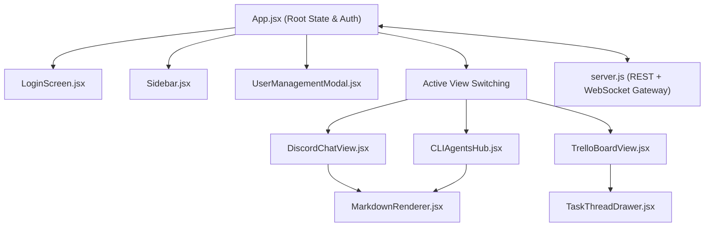

# 🚀 Collaboration Board — Complete Component & Architecture Documentation

> **Project Location:** [`d:\nas\SynologyDrive\_proyectos\vibecoding\collaboration-board`](file:///d:/nas/SynologyDrive/_proyectos/vibecoding/collaboration-board)  
> **Tech Stack:** React 18, Vite, Express (Node.js), WebSocket (`ws`), Lucide React, Modern CSS Design System  
> **Document Date:** August 5, 2026

---

## 📌 Project Overview

**Collaboration Board** is a real-time team collaboration platform combining **Discord-style chat channels**, **Trello-style Kanban task boards**, and an **Autonomous CLI Agent Management Hub**. It enables real-time messaging, task management, role-based user management, and seamless integration with AI agent processes.

---

## 🧱 Architecture Overview & Component Hierarchy

---

## 📄 Detailed Component Specifications

### 1. [`App.jsx`](file:///d:/nas/SynologyDrive/_proyectos/vibecoding/collaboration-board/src/App.jsx) — Application Root & State Controller
- **File Path:** [`src/App.jsx`](file:///d:/nas/SynologyDrive/_proyectos/vibecoding/collaboration-board/src/App.jsx)
- **Role:** Root application component managing global state, user session authentication, real-time WebSocket connection lifecycle, active server/channel/view navigation, and global error toasts.
- **Key Responsibilities:**
  - Session restoration via `/api/auth/me` token validation.
  - Maintaining live WebSocket connection (`ws://localhost:3001` or dynamic host) for real-time state sync.
  - Managing navigation between views (`chat`, `board`, `agents`).
  - Handling server creation and user management modal toggles.
  - Toast error notifications display.

---

### 2. [`Sidebar.jsx`](file:///d:/nas/SynologyDrive/_proyectos/vibecoding/collaboration-board/src/components/Sidebar.jsx) — Server & Channel Navigation Drawer
- **File Path:** [`src/components/Sidebar.jsx`](file:///d:/nas/SynologyDrive/_proyectos/vibecoding/collaboration-board/src/components/Sidebar.jsx)
- **Role:** Side navigation bar providing access to servers, text channels, direct messages, active view tabs, and current user profile status.
- **Key Features:**
  - **Server Selection:** Icon list with active indicator pills and add-server button.
  - **View Tabs:** Quick switches between `# Chat Channels`, `📋 Trello Board`, and `🤖 CLI Agents Hub`.
  - **Channels List:** Text channels list (e.g. `#general-chat`, `#dev-tasks`, `#system-logs`) with active state highlight.
  - **Direct Messages (DMs):** Interactive list of teammates and subagents with online/offline status indicators.
  - **Footer Bar:** Logged-in user badge, role tag, user management trigger (for Admins), and logout button.

---

### 3. [`DiscordChatView.jsx`](file:///d:/nas/SynologyDrive/_proyectos/vibecoding/collaboration-board/src/components/DiscordChatView.jsx) — Real-Time Discord-Style Chat View
- **File Path:** [`src/components/DiscordChatView.jsx`](file:///d:/nas/SynologyDrive/_proyectos/vibecoding/collaboration-board/src/components/DiscordChatView.jsx)
- **Role:** Real-time text messaging interface for channels and direct messages with rich formatting, mentions, attachments, and thread drawers.
- **Key Features:**
  - **Live Message Stream:** Chronological message list with sender avatar, timestamp, badge, and reactions.
  - **Rich Markdown Formatting:** Powered by [`MarkdownRenderer.jsx`](file:///d:/nas/SynologyDrive/_proyectos/vibecoding/collaboration-board/src/components/MarkdownRenderer.jsx) for rendering code blocks, tables, lists, and links.
  - **User Mentions (`@User` / `@Agent`):** Auto-suggest popup for tagging team members or agents in chat.
  - **Reactions & Threads:** Add emoji reactions to messages and launch dedicated thread sidebars.
  - **Typing Indicators:** Real-time notification when team members or agents are typing.
  - **FileUpload & Media Attachments:** Inline preview for uploaded images and code snippets.

---

### 4. [`TrelloBoardView.jsx`](file:///d:/nas/SynologyDrive/_proyectos/vibecoding/collaboration-board/src/components/TrelloBoardView.jsx) — Kanban Task Management Board
- **File Path:** [`src/components/TrelloBoardView.jsx`](file:///d:/nas/SynologyDrive/_proyectos/vibecoding/collaboration-board/src/components/TrelloBoardView.jsx)
- **Role:** Visual task management board with drag-and-drop/customizable columns and card items.
- **Key Features:**
  - **Dynamic Columns:** Standard columns (e.g. *To Do*, *In Progress*, *In Review*, *Done*) with card count indicators.
  - **Task Cards:** Display title, description summary, tag badges, priority tags, subtask progress bar, assignee avatars, and comment counts.
  - **Add/Edit Cards:** Quick inline card creation per column.
  - **Card Selection:** Clicking a card opens the [`TaskThreadDrawer.jsx`](file:///d:/nas/SynologyDrive/_proyectos/vibecoding/collaboration-board/src/components/TaskThreadDrawer.jsx) drawer for full editing and comments.

---

### 5. [`TaskThreadDrawer.jsx`](file:///d:/nas/SynologyDrive/_proyectos/vibecoding/collaboration-board/src/components/TaskThreadDrawer.jsx) — Task Details & Thread Drawer
- **File Path:** [`src/components/TaskThreadDrawer.jsx`](file:///d:/nas/SynologyDrive/_proyectos/vibecoding/collaboration-board/src/components/TaskThreadDrawer.jsx)
- **Role:** Slide-in drawer for inspecting and editing comprehensive card details, subtasks, activity log, and comments.
- **Key Features:**
  - **Task Header & Metadata:** Editable card title, description, column status dropdown, priority tags, and assignees.
  - **Subtasks Checklist:** Interactive checklist with progress percentage bar and add/toggle subtasks capability.
  - **Activity & Comments Feed:** Real-time discussion thread per task card, linking chat mentions to task cards.
  - **Tag Manager:** Add and remove custom tags with colorful category pills.

---

### 6. [`CLIAgentsHub.jsx`](file:///d:/nas/SynologyDrive/_proyectos/vibecoding/collaboration-board/src/components/CLIAgentsHub.jsx) — Autonomous CLI Agent Hub
- **File Path:** [`src/components/CLIAgentsHub.jsx`](file:///d:/nas/SynologyDrive/_proyectos/vibecoding/collaboration-board/src/components/CLIAgentsHub.jsx)
- **Role:** Control center for monitoring, configuring, and invoking autonomous AI subagents (such as Antigravity CLI, Dev Agent, etc.).
- **Key Features:**
  - **Agent Status Grid:** Cards displaying active agents, current execution state (idle/running), model, and capabilities.
  - **Task Dispatcher:** Send direct task prompts and commands to agents with target workspace selection.
  - **Real-Time Stream Terminal:** Live terminal output window streaming logs from active agent tasks via WebSockets.
  - **Execution History:** Past execution logs with status filter and quick rerun triggers.

---

### 7. [`UserManagementModal.jsx`](file:///d:/nas/SynologyDrive/_proyectos/vibecoding/collaboration-board/src/components/UserManagementModal.jsx) — User & Role Administration Modal
- **File Path:** [`src/components/UserManagementModal.jsx`](file:///d:/nas/SynologyDrive/_proyectos/vibecoding/collaboration-board/src/components/UserManagementModal.jsx)
- **Role:** Modal dialog for administrators to manage team member accounts, roles, and status.
- **Key Features:**
  - **User Directory:** View all users, roles (`Admin`, `Developer`, `Agent`), email, and status.
  - **Account Creation:** Form to provision new team members or AI subagent accounts.
  - **Role Assignment:** Modify access levels and roles dynamically.

---

### 8. [`LoginScreen.jsx`](file:///d:/nas/SynologyDrive/_proyectos/vibecoding/collaboration-board/src/components/LoginScreen.jsx) — Authentication Screen
- **File Path:** [`src/components/LoginScreen.jsx`](file:///d:/nas/SynologyDrive/_proyectos/vibecoding/collaboration-board/src/components/LoginScreen.jsx)
- **Role:** Gateway authentication interface for user sign-in.
- **Key Features:**
  - Email & Password input form with validation.
  - Quick-login demo buttons (`Dev (You)`, `Alex Rivera`, `Agent Antigravity`).
  - Sleek glassmorphic backdrop with error alert callouts.

---

### 9. [`MarkdownRenderer.jsx`](file:///d:/nas/SynologyDrive/_proyectos/vibecoding/collaboration-board/src/components/MarkdownRenderer.jsx) — Formatting Utility Component
- **File Path:** [`src/components/MarkdownRenderer.jsx`](file:///d:/nas/SynologyDrive/_proyectos/vibecoding/collaboration-board/src/components/MarkdownRenderer.jsx)
- **Role:** Custom Markdown rendering engine used across Chat, Task Threads, and Agent Hub.
- **Key Features:**
  - Renders markdown headers, bold/italic, lists, blockquotes, and tables.
  - Syntax highlighted code blocks with language badge and copy trigger.
  - Highlights user `@mentions` with interactive avatar tooltips.

---

### 10. [`server.js`](file:///d:/nas/SynologyDrive/_proyectos/vibecoding/collaboration-board/server.js) — Express & WebSocket Server Backend
- **File Path:** [`server.js`](file:///d:/nas/SynologyDrive/_proyectos/vibecoding/collaboration-board/server.js)
- **Role:** Node.js backend managing REST API endpoints, WebSocket event broadcasting, file uploads, and session persistence in [`users.json`](file:///d:/nas/SynologyDrive/_proyectos/vibecoding/collaboration-board/users.json).
- **Key Features:**
  - **Auth REST API:** `/api/auth/login`, `/api/auth/me`, `/api/auth/logout`.
  - **Workspace REST API:** `/api/state`, `/api/servers`, `/api/messages`, `/api/cards`.
  - **WebSocket Gateway:** Broadcasts `message_created`, `reaction_added`, `typing_start`, `typing_stop`, `card_updated`, and `agent_log` events to connected clients.

---

## 🛠️ Data Flow Summary

1. **Client Action** (e.g. User posts message in `#general-chat` or updates a Kanban task card).
2. **REST / WS Dispatch** -> Sent via HTTP POST or WebSocket payload to `server.js`.
3. **State Mutation** -> `server.js` updates memory state and persists changes.
4. **Real-Time Broadcast** -> `server.js` emits WebSocket event to all connected clients.
5. **UI Update** -> `App.jsx` handles message/card state update, re-rendering affected components ([`DiscordChatView`](file:///d:/nas/SynologyDrive/_proyectos/vibecoding/collaboration-board/src/components/DiscordChatView.jsx), [`TrelloBoardView`](file:///d:/nas/SynologyDrive/_proyectos/vibecoding/collaboration-board/src/components/TrelloBoardView.jsx), etc.) instantaneously.
