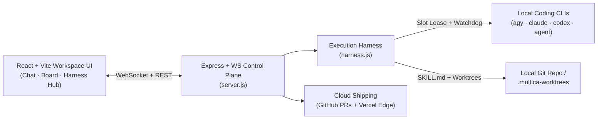

# Tandem (`tandem-dev`)

**Make humans and local AI coding agents work as one team.**

Tandem is a self-hosted collaborative engineering workspace uniting real-time team channels, a drag-and-drop Kanban task board, a local CLI agent execution harness, reusable `SKILL.md` bundles, and continuous shipping to **GitHub** and **Vercel**.

---

## Core Capabilities

### 1. Local CLI Agent Execution Harness (`harness.js`)
Inspired by modern agent control-plane harnesses (`multica-ai/multica` v0.12.x), Tandem orchestrates local coding CLIs (**Antigravity CLI (`agy`)**, **Claude Code (`claude`)**, **Codex CLI (`codex`)**, **Cursor Agent CLI (`agent -p`)**, or custom binaries) directly on your machine:
- **Cache-Friendly Two-Part Briefs**: Static runtime identity + `SKILL.md` prefix followed by dynamic per-turn context (`[On Behalf Of]`, `[Project Workflow]` status map, `[Execution Boundary]`, `[Connected Apps]`, and tail-10 thread context).
- **Live Mid-Run Steering (`--steer`)**: Commenting on or steering an active card run injects `[ADDITIONAL GUIDANCE]` / `[ADDITIONAL INPUT]` supplements into the active turn (or coalesces queued wakeups) instead of spawning duplicate overlapping processes.
- **9-Stage Monotonic Phase Telemetry**: Tracks `claimed` → `prepare_started` → `skills_ready` → `environment_ready` → `runtime_started` → `first_output_received` → `first_tool_use` → `turn_completed` → `finished` with millisecond timings.
- **Concurrency Slot Leasing & Watchdogs**: Configurable max parallel task slots (`1–8`), idle output watchdogs, max turn timeouts, and safe child PID-tree cancellation.
- **Isolated Git Worktree Mode**: Run tasks in-place or inside isolated per-issue worktrees (`.multica-worktrees/<card-id>`).
- **Token Stream Redaction & Failure Classification**: Automatically masks leaked credentials (`ghp_*`, `github_pat_*`, `vcel_*`, `sk-*`, `Bearer`) in `stdout`/`stderr` and classifies errors (`rate_limit`, `quota_exceeded`, `context_overflow`, `auth_error`, `binary_not_found`, `provider_5xx`) with actionable remediation hints.

### 2. Reusable `SKILL.md` Bundles & Quick Actions
- **Workspace `SKILL.md` Bundles**: Author, version (`--base-revision` optimistic locking), and bind reusable engineering skills to specific agents.
- **Saved Quick Actions**: 1-click prompt workflows (public workspace actions or user-scoped private actions) runnable directly from any board card.

### 3. Real-Time Channels, Threads & Kanban Board
- **Channels & Threads**: Public and private RBAC-protected channels, `@mention` autocomplete for teammates and AI bots, side-panel message threads, and 1-click **Convert Message/Thread to Task**.
- **Kanban Task Board**: HTML5 drag-and-drop across workflow columns, sub-task checklists with progress tracking, custom label management, and live execution trace terminals.

### 4. GitHub & Vercel Shipping Pipeline
- Link tasks to feature branches (`feat/...`), open and merge **GitHub Pull Requests**, and trigger **Vercel Preview / Production** deployments with live deployment logs.

---

## Architecture



---

## Quick Start

### Prerequisites
- **Node.js** 18+
- *(Optional)* Local AI CLI engines installed on `PATH`: `agy` (Antigravity), `claude` (Claude Code), `codex`, or Cursor CLI (`agent` from https://cursor.com/docs/cli/overview — plus `agent login` or `CURSOR_API_KEY`), plus `gh` / `git` and `vercel`. The CLI must be installed on the same host that runs `node server.js`.

### Installation & Run

```bash
git clone https://github.com/josecarlospm/tandem-dev.git
cd tandem-dev
cp .env.example .env
npm install
npm run dev
```

- **Frontend UI**: `http://localhost:5173`
- **Backend API & WebSocket**: `http://localhost:3001`

### First-Run Authentication & RBAC
Tandem enforces Role-Based Access Control (**Owner**, **Admin**, **User**) backed by `scrypt` password hashing (`users.json`, excluded from Git):
- Set `TANDEM_OWNER_EMAIL` and `TANDEM_INITIAL_PASSWORD` in `.env` prior to first launch, **or** leave `TANDEM_INITIAL_PASSWORD` empty to have Tandem generate a cryptographically random bootstrap password and print it once to your local server terminal on initial setup.
- Additional team members and roles can be provisioned after sign-in from **Manage Team & Permissions** or updated via `/api/auth/change-password`.

---

## Project Structure

```text
tandem-dev/
├── harness.js                         # 9-phase recorder, slot coordinator, token redactor, failure classifier & brief builder
├── server.js                          # Express REST auth + WebSocket real-time state, RBAC, CLI runner & GitHub/Vercel handlers
├── .env.example                       # Environment configuration template
├── index.html                         # App entry HTML (Inter + JetBrains Mono)
├── src/
│   ├── App.jsx                        # Workspace shell, session restore & WebSocket client state
│   ├── index.css                      # Obsidian & Zinc design system tokens and component styles
│   └── components/
│       ├── LoginScreen.jsx            # Minimalist RBAC sign-in card
│       ├── Sidebar.jsx                # Collapsible workspace rail, segmented navigation & channel creator
│       ├── DiscordChatView.jsx        # Real-time channels, threads, @mentions & Convert-to-Task flow
│       ├── TrelloBoardView.jsx        # Drag-and-drop Kanban board with PR, Vercel & run status chips
│       ├── TaskThreadDrawer.jsx       # Card detail modal: 9-phase stepper, live --steer, checklists & shipping
│       ├── CLIAgentsHub.jsx           # Harness Daemon settings, SKILL.md editor, Quick Actions & GitHub/Vercel hub
│       ├── UserManagementModal.jsx    # Owner/Admin team directory & role management
│       └── MarkdownRenderer.jsx       # Rich Markdown, code blocks & @mention pills
└── COMPONENT_DOCUMENTATION.md         # Detailed component reference
```

## License

MIT
